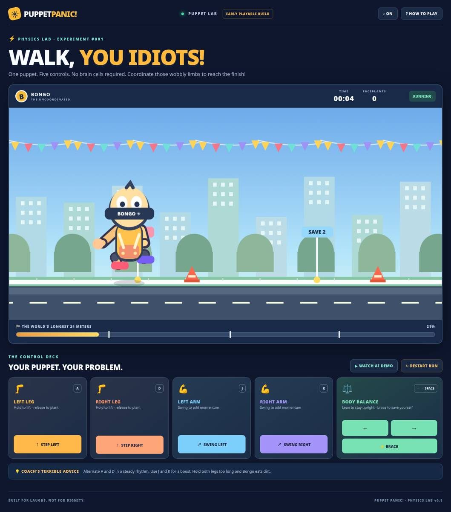

# PUPPET PANIC! — Puppet Lab 🦵💥

**Five puppets. Twenty-three controllers. Zero coordination.**

Puppet Panic! is an original TV + phones cooperative-physics party game in development. Our first **playable browser prototype** is **Walk, You Idiots!**: control Bongo's limbs separately, stumble your way through hazards, and reach the finish.



## Try the current prototype

- Open **index.html** on a web server, or use the project URL after Pages deployment is configured.
- Click **LET'S MAKE A DISASTER**.
- Alternate holding/releasing **A** (left leg) and **D** (right leg). Planting each foot propels Bongo forward.
- Press **J** and **K** to swing individual arms for a little extra momentum and stability.
- Hold **Left / Right arrows** to lean the torso; tap **Space** to brace (cooldown).
- Press **R** to restart and **H** for instructions, or use the on-screen touch controls.
- **WATCH AI DEMO** enables a scripted automated control pattern for demonstrating the physics; it is not a paid AI API.

At the moment, the five control channels are all available from one browser. **There is no multiplayer room or phone-to-TV synchronization yet.**

## Run it locally

Requires Node.js 20+; there are **zero npm dependencies** in this experimental prototype.

```bash
npm run dev
# open http://localhost:4173
```

Run tests and produce static output:

```bash
npm test
npm run build
# deploy dist/ as static site
```

The game is also suitable for simple static hosting (for example GitHub Pages) because it uses native browser APIs and ES modules. For best results, use a modern Chromium, Safari, or Firefox browser.

## What is already implemented

- [x] One animated, articulated assisted-puppet with simulated momentum and balance
- [x] Independent left/right leg stepping, left/right arm swinging, torso lean and brace
- [x] Recoverable falls, timed automatic get-up, fall counter and wobbly state
- [x] Camera-following cartoon running course, three checkpoints, three cones and finish
- [x] Comic facial expressions, sound synthesis, toast reactions and confetti
- [x] Working keyboard and on-screen pointer/touch controls
- [x] Auto-demo mode, restart, instructions and sound toggle
- [x] Deterministic simulation tests plus manually checked browser interactions

## Next development gates

1. **Human playtest** (Issue #1 still open): confirm the body-part controls are genuinely fun with real players. Tune cadence, penalties and fall recovery.
2. **Advanced joints / visual polish**: currently the puppet uses custom assisted torso physics and spring-damped limb particles. Evaluate replacing this with motorized Rapier 2D joints or Phaser/Matter.js integration when installation is available. Do not confuse this physics lab with a full physically constrained ragdoll.
3. **True multiplayer**: room code, authoritative TV/host simulation, WebSocket relay, phone-specific roles, reconnect, four-player team controls, five puppets, load testing with 23 devices.
4. **Events**: Don't Drop the Cake, The Impossible Climb, Swing for Your Life, and the Puppet Olympics finale.
5. **Presentation**: audio polish, animation and high-quality replay export, deployment and social sharing.

See [the full technical spec](docs/technical-game-spec.md) and [build progress](docs/progress.md).

## License and assets

Original game artwork, rendering code and synthesized sound have no third-party media dependencies in this slice. The original game code has **not** been explicitly open-source licensed by the project owner; `package.json` uses `UNLICENSED` pending that decision. Future dependencies and asset packs will be inventoried in this section and tracked by license before shipping.

### Status / limitations

- Local scripted browser interaction has been validated; a real multi-person playtest and cross-device mobile QA are pending.
- No live multi-device service or final production URL has been deployed by this commit.
- This browser-only physics proof-of-concept is a deliberate zero-dependency stepping stone toward the planned Phaser/modern physics engine.

## Teamwork Lab v0.2 (coordination rework)

**Update following player feedback:** the original lab could be completed by spamming any leg button. That loophole has been removed: only correctly sequenced, assisted steps advance the puppet. Arms alone never propel it. A valid planted foot needs the **next** leg, a 0.22–0.78-second lift, the **opposite arm**, and a weight transfer toward the **supporting** leg.

Local keyboard walkthrough (five independent roles in the future mobile version):

1. **LEFT step**: Hold **A + K + →** together for approximately 0.35 seconds. Release **A** while keeping the arm and lean briefly engaged.
2. **RIGHT step**: Hold **D + J + ←** together for approximately 0.35 seconds. Release **D** while keeping the arm and lean briefly engaged.
3. Alternate. Repeating one foot, neglecting an arm/torso controller, raising both feet, or mistiming the plant causes slips and faceplants, not automatic forward motion.
4. Press **CAKE CARRY** to play a second prototype challenge: both arm controls must grip the tray while leg players and the torso player coordinate. Tilt or drop the cake and lose layers/progress.
5. **WATCH AI DEMO** demonstrates a scripted *coordinated sequence*, not independent AI teammates or multiplayer.

The screen shows the required next foot, combo, balance danger, and cake layers. `npm test` includes exploit-regression tests for missing or incorrect team inputs. This is still a local one-puppet lab; **phone roles, 23-player connection and real-device tests are not yet implemented**.

Full design rationale: [Coordination-first game design](docs/coordination-first.md).


## Party display + role controller split (early LAN prototype)

The default URL remains the **solo physics lab** used for debugging; **real players must not use that scrollable control deck**. The new separation is:

- TV/host: `host.html` — creates a room and renders up to five simultaneous puppets (never player control buttons).
- Players: `controller.html` — enter room code + name, receive **one** assigned station, and see only its 1–3 large controls in a full-height, no-scroll layout.
- Lab: `index.html` — retains the original all-input testing panel.

**Team allocation: 2–25 players, maximum five puppets.** Use `ceil(n/5)` puppets and balance sizes by at most one player. 2–5 players create one co-op puppet. 6→3+3; 7→4+3; 9→5+4; 11→4+4+3; 15→5+5+5; 16→4+4+4+4; 19→5+5+5+4; 23→5+5+5+4+4; 25→5×5. See `docs/multiplayer-ux.md` for every possible split and role mapping.

### Run actual networked controllers on local Wi-Fi

Run `npm run dev` with Node.js 22+ on the host laptop. On that laptop visit `http://<HOST-LAN-IP>:4173/host.html` (substitute its actual local IPv4 address). All player phones must be on the same Wi-Fi and open `http://<HOST-LAN-IP>:4173/controller.html?room=<ROOM-CODE>`. Join and start from the TV host. Host computer is authoritative for physics; the local server relays role-limited control changes and assignment updates over HTTP + SSE, with tokens for each guest.

**GitHub Pages hosts static files, not this Node.js room server.** It cannot yet accept real internet multiplayer joins. Public Pages links for UI review only:

- [Five-puppet TV preview](https://adityasuresh109.github.io/Puppet-Panic/host.html?preview=23)
- [Three-puppet TV preview](https://adityasuresh109.github.io/Puppet-Panic/host.html?preview=15)
- [Body-balance phone controller preview](https://adityasuresh109.github.io/Puppet-Panic/controller.html?preview=BALANCE)
- [Two-player both-legs phone preview](https://adityasuresh109.github.io/Puppet-Panic/controller.html?preview=DUAL_LEGS)

**Honest readiness:** allocation + LAN room server + role-specific UI are built and automated-tested. A 2–25-device human playtest, final physics balance between unequal team sizes, and a **public production HTTPS/WSS relay** are not yet complete. The Pages host Create Room action requires a relay and therefore does not work on Pages yet.